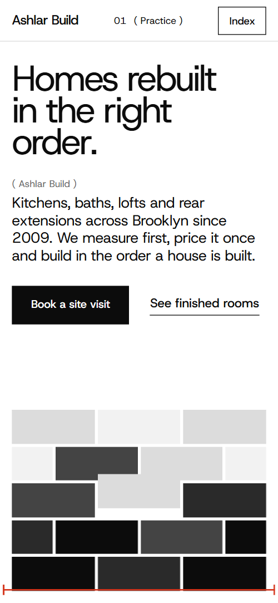

# Free HTML construction company website template with GSAP scroll animations — Ashlar Build

**One-page website for a construction company: a home renovation and extension contractor: a free HTML template in one file, with GSAP scroll animations, no build step, MIT license. Made by [8B](https://8b.com/), the AI website builder.**

[](LICENSE)  

**[Live demo](https://8bsite.github.io/construction-company-website-template/)** · **[Use this template](https://github.com/new?template_name=construction-company-website-template&template_owner=8bsite)** · **[Download ZIP](https://github.com/8bsite/construction-company-website-template/archive/refs/heads/main.zip)** · **[Template page on 8b.com](https://8b.com/templates/ashlar/)**

<a href="https://8bsite.github.io/construction-company-website-template/"></a> <a href="https://8bsite.github.io/construction-company-website-template/"></a>

<p align="center"><a href="https://8bsite.github.io/construction-company-website-template/"></a><br><sub>Scroll animation</sub></p>

A one-page site for a Brooklyn builder that does kitchens, bathrooms, lofts, rear extensions and restoration, with services and prices, a survey, finished work, crew, reviews and a site-visit form. Strict black, white and grey with one red for measuring marks; a wall of grey blocks comes apart into the room photo, scattered photos settle into a contact sheet and the word "Fixed" condenses as you scroll.

Good for: builder, general contractor or renovation company; kitchen, bathroom or loft conversion specialist; architect or design-and-build practice; any trade business that quotes from a site visit.

## Use it with an AI coding agent

Download the files into your project (in Windows PowerShell type `curl.exe`):

```bash
curl -LO https://raw.githubusercontent.com/8bsite/construction-company-website-template/main/index.html
curl -LO https://raw.githubusercontent.com/8bsite/construction-company-website-template/main/AGENTS.md
curl -LO https://raw.githubusercontent.com/8bsite/construction-company-website-template/main/LICENSE
curl -LO https://raw.githubusercontent.com/8bsite/construction-company-website-template/main/CREDITS.md
```

Then give your agent this prompt:

```text
Read AGENTS.md, then edit index.html. Use this template as the base for a site for <your business: construction company, contractor or renovation firm; services, area, prices, team>. Keep the layout, the motion and the single-file format; replace the brand name, copy, photos (use your own projects and team), prices, links and contacts, and recolour it through the CSS variables if needed.
```

Give the agent the downloaded file, not a link: from a link it would rebuild a different page. No agent? Click **[Use this template](https://github.com/new?template_name=construction-company-website-template&template_owner=8bsite)**, edit `index.html` and turn on **Settings → Pages**.

## What's on the page

- **Navigation** — top bar: wordmark, current chapter with previous/next arrows, Book a visit, Index overlay
- **Homes rebuilt in the right order.** — first screen: headline, lead, two buttons and a wall of grey blocks; second screen: room photo with a statement panel and three facts
- **Five kinds of job, one way of working** — list of services with duration and starting price beside a sticky photo frame (demo: kitchens, bathrooms, lofts, extensions, restoration)
- **A fixed price, from a measured survey.** — how quoting works: a measured photo with red dimension lines and four numbered notes
- **Rooms we handed back** — black gallery: twelve project photos with room and neighbourhood captions
- **Five materials we keep coming back to** — five material strips with a photo, name and use (demo: plaster, oak, marble, slate, steel)
- **Built in the order a house is built** — five work stages laid as blocks of a wall, each with a week range
- **Fixed** — guarantees: one huge condensed word and three written promises
- **The people who quote are the people on site** — team row: five portraits at varied heights with name and trade, Shuffle button
- **What people say after handover** — four client quotes on grey-to-black cards that stack as you scroll
- **Before you call** — questions and answers (native &lt;details&gt;)
- **Book a site visit** — site-visit request: address, phone, email, hours, a photo and a form (placeholders)
- **Footer** — black footer: big back-to-top link, address, contacts, section links, licence line, copyright and the Design: 8B credit

## Design

Palette:          
Fonts: Host Grotesk, TikTok Sans (Google Fonts). Change both through the CSS variables in the `:root` block at the top of `<head>`. A big display line with `style="--len:N"` fills its width: set N to its new number of characters.

- Chapter numbers and labels are written in each section's intro ("02 ( Services )"), in the Index list and in the footer's "Back to 01 Practice ↑" link; the top bar reads them from the sections. When you add, remove or rename a section, update all three.
- The wall of blocks on the first screen and the process blocks are HTML and CSS, not images: restyle them through the colour variables.
- Red (--color-7) is used only for measuring marks, link hover lines and focus outlines; keep it off large areas and body text.

## Before you publish

- Replace everything marked `data-8b-placeholder` (social preview image, favicon, phone, email, form, social) and the invented demo facts: prices, dates, address. [AGENTS.md](AGENTS.md) lists them.
- The form sends nothing yet: connect it to Formspree or Netlify Forms, or remove it.

## Tech

GSAP 3.13.0, ScrollTrigger, Lenis 1.3.27 from jsDelivr, 107 KB, no build step. Chrome and Edge 108+, Safari 15.4+, Firefox 101+ (it uses cascade layers, small/dynamic viewport units). With "reduce motion" on, the page is complete and still.

## License

MIT, see [LICENSE](LICENSE). Photos, fonts and libraries keep their own licences: [CREDITS.md](CREDITS.md). More free templates: [8b.com/templates](https://8b.com/templates/) · [github.com/8bsite](https://github.com/8bsite).
